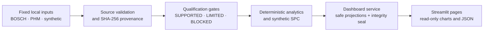

# Etch Process Support Copilot

A read-only semiconductor engineering portfolio demonstrating how to qualify data
before interpreting it. The project combines real research-data ingestion, explicit
analysis-readiness gates, deterministic analytics and synthetic SPC method qualification
with a local engineering dashboard.

The current implementation is deterministic software, not a GenAI assistant. It does
not control equipment, recommend recipes or confirm physical root cause.

## What this does not claim

“Copilot” is the project name, not a claim that the dashboard uses generative AI. This
repository does not provide a chat assistant, RAG system, autonomous diagnosis, recipe
recommendation, equipment control, production control limits or physical root-cause
confirmation. It presents qualified evidence and deterministic calculations for a local,
trusted-user engineering workspace.

## 60-second dashboard walkthrough

Start the local dashboard with the command below, then follow this path using only the
committed synthetic fixture:

```sh
uv sync --frozen --python 3.12 --extra dashboard --extra dashboard-test
.venv/bin/streamlit run streamlit_app.py
```

1. Open **Overview & readiness**, select **synthetic**, and verify engineering readiness.
2. Open **Synthetic SPC investigations**, select **S2**, and run the candidate
   investigation. This is the admitted synthetic scenario and shows frozen candidate
   I-MR evidence, signals and estimator comparison.
3. Run **S1** and **S3** to see deterministic refusal explanations for baseline admission
   and invalid metrology.
4. Open **Provenance & JSON exports** to inspect or download the freshness-checked,
   sanitized evidence projection.

The same flow works without BOSCH or PHM downloads; missing external datasets are shown
as unavailable rather than fetched automatically.

## Repository and verification status

This documentation audit started from local branch `feature/github-actions-ci` at
commit `dd21baf` (`ci: add portable engineering validation workflow`). The working tree
was clean and the branch was neither ahead of nor behind its locally cached upstream
reference. That is a local Git observation, not a fresh check of the remote repository.

The repository contains a pull-request workflow for portable verification. Its presence
does not by itself prove that GitHub Actions passed for this commit. This README therefore
does not claim a current public CI result; verify the exact commit and conclusion in the
pull request's checks before relying on it. The [continuous integration policy](docs/CONTINUOUS_INTEGRATION.md)
defines what the workflow runs, while the [Phase 5 verification record](docs/PHASE_5_VERIFICATION.md)
preserves separately dated, provisioned local evidence.

## Engineering workspace

| Section | What an engineer can inspect |
| --- | --- |
| Overview | Dataset availability, readiness decisions, prerequisites and limitations |
| BOSCH process evidence | Elapsed sensor trends, descriptive statistics, compatible run comparisons and metrology coverage/reconstruction inventory |
| Synthetic SPC | Baseline admission, frozen candidate Individuals–Moving Range charts, signals and transition boundaries |
| PHM equipment evidence | Sensor-feature inventory, missingness, duplicates and recorded event categories |
| Provenance | Source fingerprints, calculation versions and freshly verified JSON exports |

## Architecture

```text
Streamlit dashboard and display-only charts
                  |
Presentation service: fixed dataset registry, sanitized evidence,
source revalidation, bounded session results and verified exports
                  |
Public readiness-gated analytics and synthetic SPC APIs
                  |
Qualification contracts, source validation and SHA-256 provenance
                  |
Local research datasets / committed public synthetic fixtures
```

The data flow is intentionally one-way:



The dashboard does not bypass a gate or recompute engineering statistics in the UI.

The UI reuses backend calculations. It does not independently compute engineering
statistics or override readiness decisions. Display sampling preserves critical points,
missing-data gaps and transition boundaries without changing analytical results.

Relevant modules are `src/etch_copilot/analytics/`, `qualification.py`,
`synthetic/` and `dashboard/`. See the
[dashboard architecture guide](docs/ENGINEERING_DASHBOARD.md) for the API mapping.

## Scientific boundaries

- `SUPPORTED`, `LIMITED` and `BLOCKED` are backend decisions, not UI preferences.
- Synthetic candidate limits are method demonstrations, never operational control limits.
  For the committed fixture, S1 fails baseline admission, S2 admits a frozen candidate
  baseline, and S3 is blocked by invalid metrology. Outcomes are computed from the data.
- Real BOSCH and PHM SPC and all operational SPC remain blocked.
- BOSCH source units are labelled unverified where appropriate. Coverage and reconstructed
  metrology do not establish measurement uncertainty or authorize unsupported calculations.
- PHM recorded events do not establish fault onset or diagnostic accuracy. Sampling bias
  and retained duplicates remain part of the interpretation.
- Synthetic values do not validate plasma physics, metrological traceability or causality.

The [engineering standards guide](docs/ENGINEERING_STANDARDS_GUIDE.md),
[analytics contract](docs/DETERMINISTIC_ANALYTICS_CONTRACT.md) and
[synthetic SPC method](docs/SYNTHETIC_SPC_METHOD.md) document these boundaries.

## Reproducible local setup

Use a repository checkout, Python 3.12 and an installed `uv` package manager.
Verification was performed on Python 3.12.13 / macOS ARM64. The verification tools use
POSIX filesystem protections; Windows support has not been established.

From the repository root:

```sh
uv sync --frozen --python 3.12 --extra dashboard --extra dashboard-test
.venv/bin/streamlit run streamlit_app.py
```

Streamlit prints the loopback address to open. Run from the repository root so its
checked-in configuration is applied. Access is bound to `127.0.0.1`, usage telemetry is
disabled and CORS/XSRF protection remains enabled. This is a local trusted-user workspace,
not a remotely deployed or multi-user service.

Dependency installation needs network access initially. The dashboard operates offline
after installation. For backend-only work, use `uv sync --frozen --python 3.12` without
the optional dashboard extras.

## Synthetic demonstration without research downloads

The public fixture in `data/synthetic/demo-v1/` is included in Git; no PDFs or external
research datasets are needed for this demonstration.

1. Launch the dashboard and open **Synthetic SPC investigations**.
2. Select **S2**, then **Run candidate investigation**. Inspect the frozen baseline ID,
   candidate I-MR charts, Phase I/II observations, signals and estimator comparison.
3. Run **S1** and **S3** to inspect the returned blocking explanations.
4. Open **Provenance & JSON exports** and download the verified evidence.

The approved `tests/fixtures/synthetic/demo-v1/scenario_truth.json` is deliberately
tracked as a reproducibility and evaluation fixture. It is hidden from the application,
not secret from repository readers. Production ingestion, analytics and the dashboard
never load it; application-visible source directories reject truth files. Unintended
truth-file copies are ignored. See the
[synthetic data contract](docs/SYNTHETIC_DATA_CONTRACT.md).

## Optional research datasets

Obtain research files separately under their applicable access and licensing terms.
This repository does not redistribute them or automatically download them. Use the
validated dataset versions; arbitrary similarly named files may fail validation.

| Local directory | Required files |
| --- | --- |
| `data/external/bosch/` | `Process_data.nc`, `Dictionary_process.nc`, `Si_Oxide_etch_89_points.csv`, `Lot_status.xlsx` |
| `data/external/phm_ion_mill_2018/compact/` | `equipment_sensor_data.parquet`, `fault_events.csv`, `dataset_manifest.json`, `validation_report.json`, `README.md` |

The BOSCH primary scientific reference, when available and permitted, belongs at
`data/external/research/Readme.pdf`. Its content and presence are included in freshness
checks. Full local integration tests expect the established research files and reference.
Missing datasets remain unavailable in the UI; the synthetic demonstration still works.

External data, the four local standards PDFs, generated reports and screenshots remain
Git-ignored. The repository's [license](LICENSE) does not grant rights to third-party data
or references.

## Tests and verification

Portable checks use committed synthetic data and temporary test fixtures:

```sh
.venv/bin/pytest -q -m "not integration"
.venv/bin/ruff format --check .
.venv/bin/ruff check .
.venv/bin/mypy src
```

Run these checks with dashboard extras installed to include AppTest and chart tests.
Those UI tests skip in a backend-only installation. For strict typing of the complete
source tree, install the dashboard extra.

After provisioning the optional research datasets, run the complete suite:

```sh
.venv/bin/pytest -q --cov=etch_copilot --cov-report=term-missing
.venv/bin/python scripts/benchmark_dashboard.py
```

The dated Phase 5 baseline recorded **172 passing tests**, including **22 dashboard
tests**, with **94% reported statement coverage** in its provisioned environment. Those
numbers describe that recorded snapshot; they are not a current-branch or CI result.
See the [verification record](docs/PHASE_5_VERIFICATION.md) for review findings and measurements.
See [continuous integration](docs/CONTINUOUS_INTEGRATION.md) for the portable GitHub
Actions policy and its deliberate external-data boundary.

For reproducible browser captures, install Chromium once, keep the dashboard running
in another terminal, and use the provisioned research datasets:

```sh
.venv/bin/python -m playwright install chromium
.venv/bin/python scripts/verify_dashboard_browser.py
```

The script blocks non-loopback HTTP, exercises the dashboard and saves genuine BOSCH/S2
captures under ignored `data/processed/dashboard/`. Screenshots are not committed or
embedded here; these instructions reproduce them locally.

## Integrity and remaining limitations

Sources are reverified before retained evidence is displayed or exported. Results are
bound to their dataset and selection with a server-local integrity seal. Fixed paths,
field allowlists, symlink rejection and bounded storage protect the presentation boundary.

Freshness is checked on actions, not continuously in an untouched browser. Already
displayed evidence, downloaded files and briefly retained media URLs cannot be revoked.
No GenAI, RAG, equipment control, recipe recommendation or root-cause confirmation is
implemented. Browser smoke tests are not a full accessibility certification.
