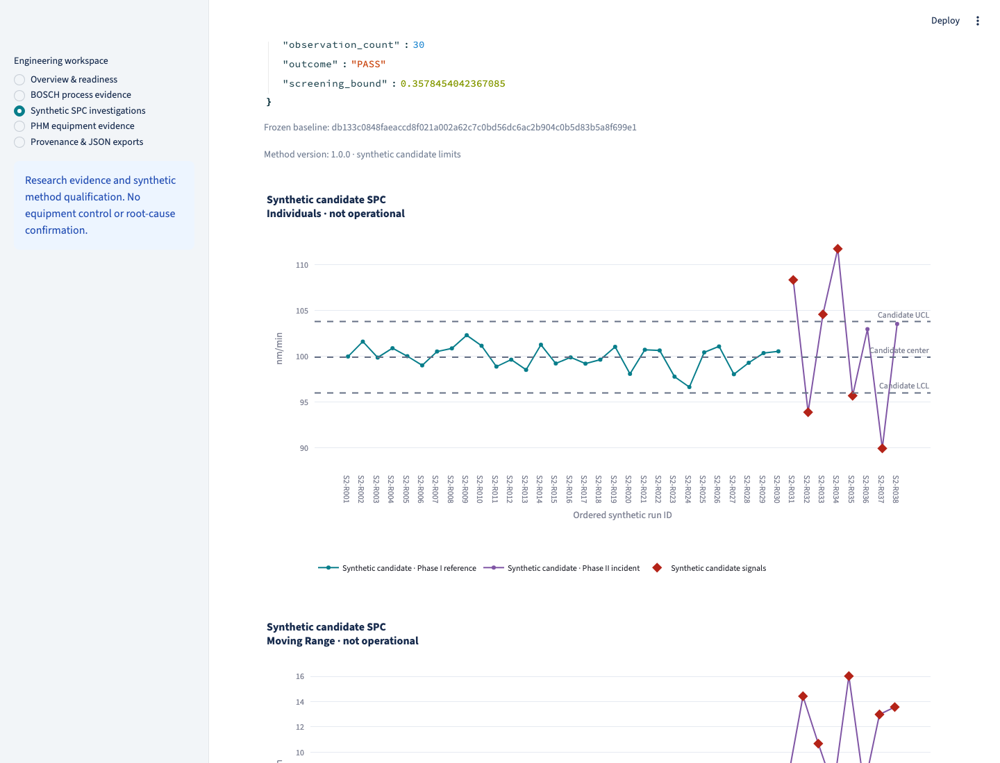
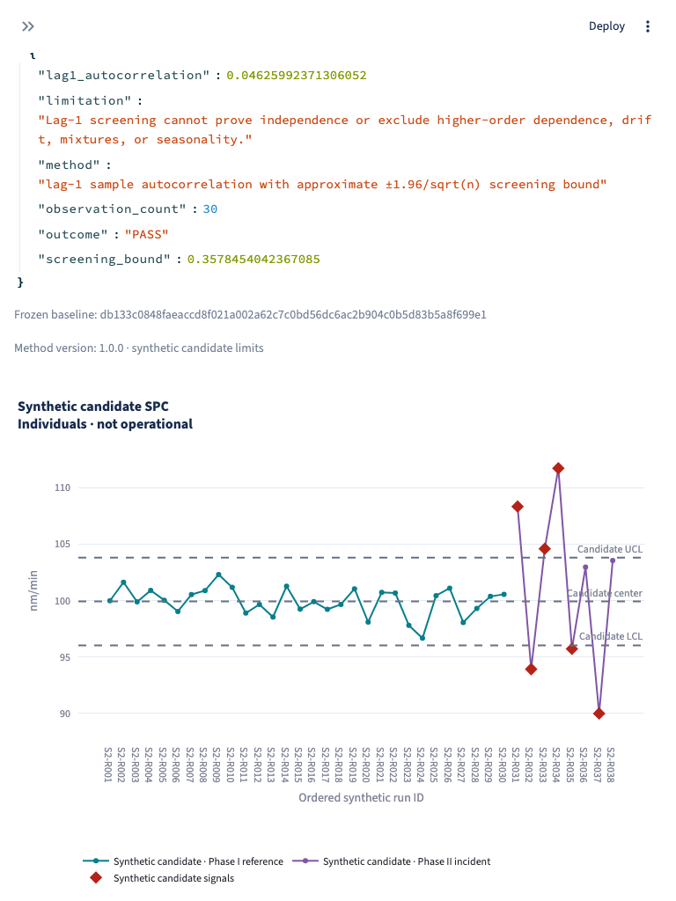
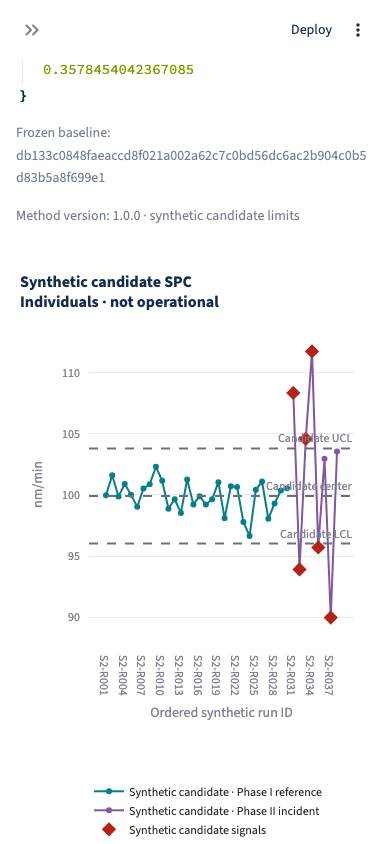
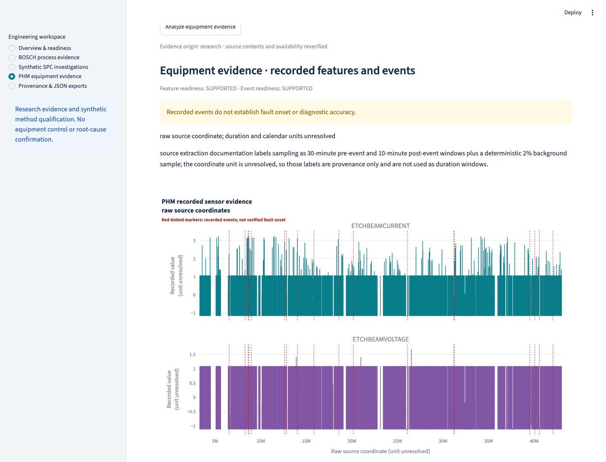
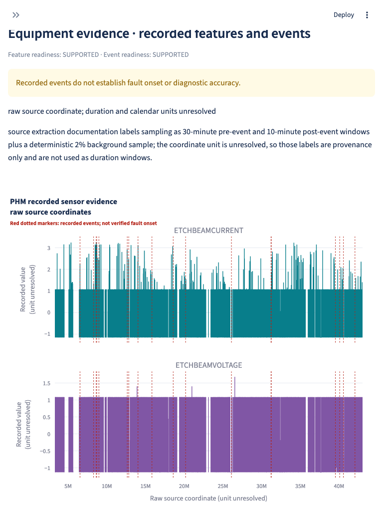
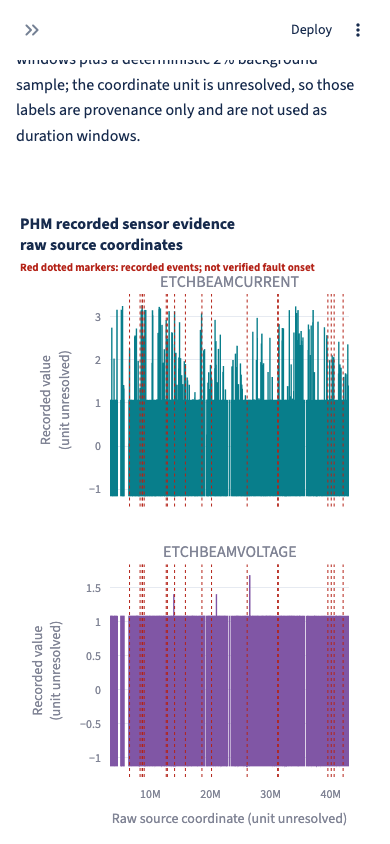

# Dashboard walkthrough

These captures are generated by the local browser verification script and use the
committed synthetic fixture. They are portfolio illustrations, not substitutes for the
underlying qualification results.

## 1. Run the admitted S2 investigation

Choose **Synthetic SPC investigations**, select **S2**, and run the candidate
investigation. The charts separate the Phase I reference from Phase II incident
observations and label the limits as synthetic and non-operational.

Desktop capture: the dashboard shows the frozen baseline, candidate limits, incident
signals and the explicit non-operational scope.

## 2. Check the responsive layout

The same evidence remains available at narrower viewports; the numerical tables are the
accessible alternative to chart hover and color interpretation.

The browser verification script also checks S1/S3 refusal states, provenance downloads,
source freshness and the loopback-only network policy. See
[`verify_dashboard_browser.py`](../scripts/verify_dashboard_browser.py) for the exact
journey and regeneration command.

## 3. Inspect PHM recorded sensor evidence

When the separately provisioned PHM source is available, choose an equipment identifier
and analyze its evidence. The two panels show only the recorded `ETCHBEAMCURRENT` and
`ETCHBEAMVOLTAGE` fields against raw source coordinates. Line breaks preserve missing
recorded values and unsampled coordinate intervals. Vertical markers are recorded events,
not verified fault onset.

The source extraction documentation's “30-minute pre-event / 10-minute post-event” labels
are displayed as provenance only. Because the coordinate unit, calendar origin and timezone
are unresolved, the dashboard does not interpret those labels as duration windows or infer
calendar time.

